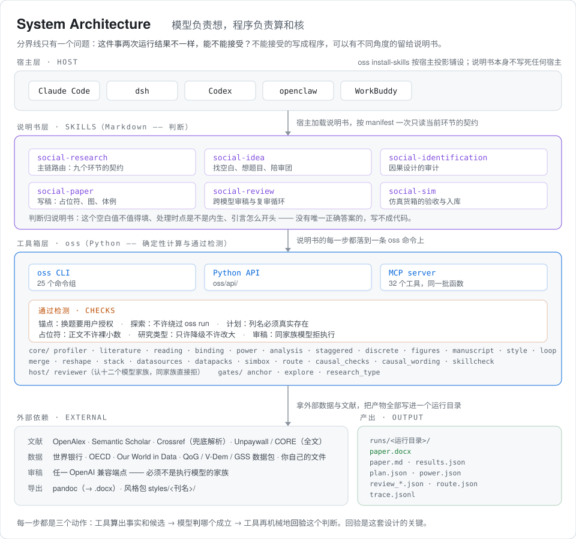

# 设计与架构

写给想知道「凭什么信」的人。只想用起来，看 [README](../README.md) 和 [使用说明](使用说明.md) 就够了。

- [一 · 谁算，谁判](#一--谁算谁判)
- [二 · 每种方法上挂着哪些检查](#二--每种方法上挂着哪些检查)
- [三 · 三个完整实例](#三--三个完整实例)
- [四 · 边界](#四--边界)
- [五 · 代码在哪，用了什么](#五--代码在哪用了什么)

---

## 一 · 谁算，谁判

<p align="center">
  <picture>
    <source media="(prefers-color-scheme: dark)" srcset="images/architecture-dark.svg">
    <source media="(prefers-color-scheme: light)" srcset="images/architecture-light.svg">
    
  </picture>
</p>

系统由两半组成：**说明书**是六份写给模型看的 Markdown，管判断；**工具箱**是一套 Python 程序，
管计算与检查。分界线只有一个问题——这件事两次运行结果不一样，能不能接受？

| 不能接受 → 工具箱 | 可以有不同角度 → 说明书 |
|---|---|
| 缺失率、样本量、统计功效 | 这个研究空白值不值得填 |
| 回归系数、标准误、平行趋势检验 | 处理时点是不是内生的 |
| 拼数据丢了多少、丢的是谁 | 该读哪几篇文献 |
| 这条引文在原文里找不找得到 | 引言怎么开头、局限怎么措辞 |

### 每一步都是三个动作

**算** —— 工具给出事实和候选。拼两份数据时它说：丢了 25%，因为一边写 `Korea (the Republic of)`、
一边写 `South Korea`，长得像的候选有这几对。

**判** —— 模型做认定。「这一对确实是同一个国家」是判断，工具不替它做。如果工具自动套上去，
朝鲜会被安静地接到韩国上，之后没有任何检查抓得到。

**回验** —— 工具再机械地核这个判断。模型说某篇文献承认了某个局限，工具到原文逐字找那句话；
模型写分析计划，工具核每个列名真的存在；模型写论文，正文的统计结果只能是占位符。

**回验是支点。** 没有它，「判」那一半就不受约束。

### 为什么两边都不能少

全交给模型，有三件事它结构上做不到：

| | |
|---|---|
| 数字追不回去 | 手打一个 `0.032`，哪怕跟真算出来的一模一样，也没人能验证它从哪来 |
| 话容易说过头 | 不显著写成「没有效应」；关联写成「导致」；两个不同口径的数放在一句话里比 |
| 结果不可复现 | 同一句话跑两次，缺失率、样本量、功效都可能不一样 |

全写成程序也不行。「这个空白值不值得填」「这个识别策略站不站得住」没有唯一正确答案，
硬写成规则，换个题目就不对。这样分的好处有四个：

1. 数字和引用由程序保证，不依赖说明书写得好不好
2. 工具箱有几千项测试，「功效算错」「共线没查出」在提交前就被拦住
3. 找空白的角度、各学科检测标准的松紧、审稿人该问什么全在 Markdown 里，做社科的人自己能改
4. 失败看得见——审稿后端挂了不算通过，文献源不可用不算「没人做过」

## 二 · 每种方法上挂着哪些检查

三种性质：

| | 程序动作 | 条数 |
|---|---|---|
| 拦住不让走 | 命令非零退出，这一步跑不下去 | 2 |
| 强制改计划 | 换估计量，一键应用 | 1 |
| 强制补做或写明 | 不做处置就不许交付 | 28 |

第三类不是「不许交稿」，是「必须交代」——每条处方三选一：照做、驳回并写理由、写进论文局限。
少一条都不给导出。

### 双重差分族 `did` `did_cs` `event_study`

| 检查 | 防什么 | 动作 |
|---|---|---|
| `staggered_twfe` | 政策分批推开却还用老 TWFE，估计量本身是偏的 | 强制换 Callaway–Sant'Anna |
| `pretrend_fail` | 平行趋势联合检验没过 | 写进局限，结论收着写 |
| `pretrend_underpowered` | 检验「通过」了，但它没有功效发现违背——「没测出来」被当成「没问题」 | 强制披露预检功效 |
| `low_breakdown` | breakdown 值太低，处理后一点违背结论就翻 | 强制写明结论有多脆 |
| `cohort_hetero` | 不同批次的效应差别大，平均数掩盖了异质性 | 强制披露 |
| `reversal` | 有单位处理后效果反转 | 强制加一项剔除它们的稳健性 |

配套跑 Bacon 分解与联合预趋势检验。

### 工具变量 `iv`、倾向得分 `iptw`

`weak_iv` 在有效 F 不够时强制报 Anderson–Rubin 区间（对弱工具稳健），因果论文弱工具却没引
AR 区间直接拒导出。`iv_ols_gap` 盯 IV 与 OLS 差太远——通常意味着工具在捕捉别的东西。
`iv_gray` 在 F 落在灰区时不自己下结论。

### 普通回归下因果结论 `ols_fe`

用 OLS 说「X 影响 Y」照样过识别审计。配遗漏变量敏感性——Oster δ、稳健性值、E-value，
回答「得有多强的一个遗漏变量才能把结论推翻」。`weak_sensitivity` 在敏感性太弱时强制披露。

### 断点、离散、多层

`near_threshold`（断点附近样本太稀）；`plan.logit.separated`（完全分离，系数发散）、
`plan.logit.not_converged`；`plan.mixed.few_groups`（组太少，随机效应估不出来）、
`plan.mixed.rationale_missing`（用了多层模型却说不出为什么用）。

### 仿真货箱

仿真的数据是模拟器跑出来的，检查落在「这批数据配不配进入分析」上，接回主链之前就判：

| 检查 | 防什么 |
|---|---|
| 配料单十二项必填 | `simulator` `simulator_version` `model` `model_provider` `temperature` `prompts` `population` `conditions` `n_reps` `rounds` `interview_plan` `contamination_note`，缺一项拒收入库 |
| 钥匙列齐不齐 | `states.csv` 要有 condition / rep / wave / agent_id，`events.csv` 要有八列 |
| 方差压扁 | 所有智能体行为趋同、结果假得平滑——LLM 驱动的模拟最常见的坏法，验收时算得出来 |
| `relation_flipped` | 声明的关系方向和跑出来的符号相反 |
| `degenerate_column` | 某一列在所有场次里都是同一个值，等于没有变异 |
| `simulation_fidelity` | 模拟结果与真实基准的偏离，强制写进局限 |

判断一个位置堵不堵得住，看那里有没有**算得出来的事实**。货箱的四根钥匙列是算得出来的，
所以入口检查在仿真这里立得住。仿真研究照样过环节 7.5 的识别审计。

### 横跨所有估计量

`weights_unused`（有权重没用）、`survey_few_psu`（初级抽样单位太少）、
`survey_design_approx`（这个估计量的方差是近似的，逐处写明）、`survey_weight_gap`。

### 唯二会直接中断的两道

`power_fail` 和 `power_mode_mismatch`——功效撑不起这个设计，**在跑分析之前就停**，
不让先跑完再挑个好看的说法。

## 三 · 三个完整实例

[`examples/`](../examples/) 下是三次真实运行的全部产物——源稿、填好数字的稿、分析计划、
结果与诊断、两版 Word。三种研究类型，三本期刊的体例，`oss eval` 的 must 级检查全部通过。

| 实例 | 类型 | 数据 | 期刊体例 |
|---|---|---|---|
| [差序格局的城乡与代际分布](../examples/descriptive-chaxu-geju/) | 描述 `describe` | CGSS 2015 | 社会学研究 |
| [公共服务获得感测的是谁的获得](../examples/measurement-huodegan/) | 测量 `ols_fe` | CGSS 2013 | 管理世界 |
| [宗教参与、捐赠与对陌生人的信任](../examples/causal-religion-trust/) | 因果 `iv` | CGSS 2012 | 中国社会科学 |

把任一例的 `paper.md` 和 `paper_rendered.md` 对照着看，最容易理解占位符机制：
源稿里写不出数字，数字是渲染时从 `results.json` 填进去的。

工具箱另有 `pytest` 4079 项测试（4 项需要真实网络或模型调用，默认跳过）。

## 四 · 边界

| | 覆盖到哪里 / 怎么处理 |
|---|---|
| 中文文献 | 三条路并用。**主力是网页通路**：Agent 自己按阵营组检索式上网搜、把全文下成 `.pdf` / `.htm`，`oss lit import` 收进语料并挡掉不是研究论文的（搜是判断归 Agent，验是计算归工具）。另两条是 2018 年前核心刊的程序化检索，以及知网 / 万方导出题录的批量导入。走后两条进来的记录没有 OpenAlex 编号、顺不了引文网络，网页通路来的则带全文直接进精读 |
| 全文精读 | 开放获取的论文自动抓取（OpenAlex、落地页、Unpaywall、CORE 四条路依次试）；闭源期刊把下载好的 PDF 整批喂进来。没读到全文的文献，论文里不许写「首次」 |
| 复杂抽样 | 权重进估计、标准误与功效；声明了初级抽样单位与分层就按设计算。几处仍是近似——`did_cs` 的分层不进方差、Bacon 分解不加权也不聚类、`sample_filter` 先删行再算而非子总体估计、功效只折整群与权重。每一处都写在诊断里 |
| 构造变量 | 派生列由模型写脚本算，工具登记指纹并检查论文有没有交代算法，不校验算得对不对 |
| 替代解释 | 「替代解释审稿人」对着结果专门找「还能被什么解释」，保证有人找；找得全不全取决于模型的知识面，所以设计成可换模型的一层 |
| 说明书那一半 | 靠模型遵守，所以原则是「能做成程序检查的一律做成检查」，说明书只管检查管不了的判断 |

## 五 · 代码在哪，用了什么

```
.claude/skills/       六份说明书（Markdown，源头）
  social-research/      主链路由 + 九个环节的契约（stages/）+ 跨环节硬规矩（rules/）
  social-idea/          找空白、想题目、跨模型陪审团
  social-identification/ 因果设计的审计
  social-paper/         写稿：占位符、图、中英文体例
  social-review/        跨模型审稿与复审循环
  social-sim/           接外部模拟器：验收输出、入库
oss/                  工具箱（Python）
  core/                 画像、文献、绑定、功效、分析、图、渲染、风格
  gates/                程序检查：不许私自换题、不许绕过 oss 跑回归、不许改大研究类型
  api/                  纯函数层，CLI 与 MCP 共用同一批实现
  cli/main.py           oss 命令行（25 个命令组）
  mcp/                  MCP 服务器（32 个工具）
  hosts/                五个 Agent 各自的档案
  host/reviewer.py      跨模型审稿：家族识别、流式调用
  sims/                 外部模拟器适配（OASIS / AgentSociety）
examples/             三个完整实例的产物
styles/               风格包
tests/                测试
docs/                 使用说明、各 Agent 接入、图
runs/ · data/         运行产出与数据缓存（不进仓库）
```

| 层 | 用了什么 |
|---|---|
| 运行时 | Python 3.11+ · [Typer](https://typer.tiangolo.com) · [Pydantic](https://docs.pydantic.dev) v2（产出物契约） |
| 数据 | pandas · numpy · pyreadstat（`.dta` / `.sav`）· openpyxl |
| 计量 | 自写的 OLS+FE / DID / 事件研究 / IV / IPTW / RDD / logit / ologit（numpy）· [StatsPAI](https://pypi.org/project/statspai/)（Callaway–Sant'Anna、Bacon 分解）· statsmodels（多层模型） |
| 图 | matplotlib，中英文两套发表体例，输出 PNG + PDF + 图注 JSON |
| 文献 | OpenAlex · Semantic Scholar · Crossref · Unpaywall / CORE · PyMuPDF / pypdf |
| 写作与导出 | 占位符渲染 → pandoc → `.docx`；CSL 样式（Chicago / APA / ASA） |
| 集成 | Agent skill · MCP（stdio，零额外依赖）· 任一 OpenAI 兼容端点（审稿） |
