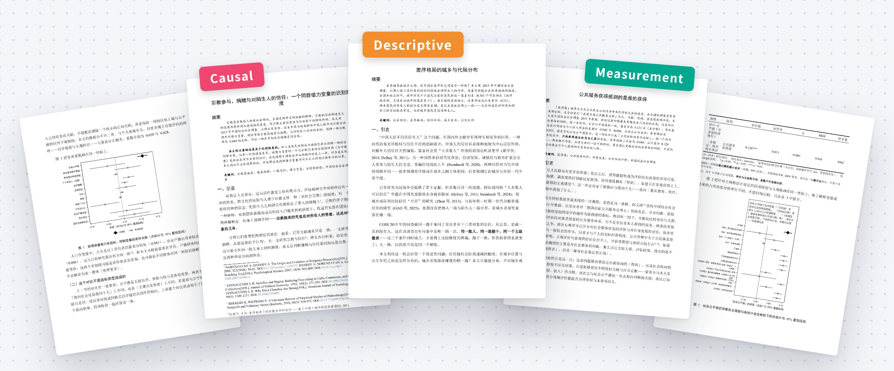
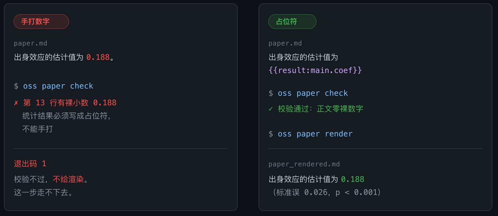

<div align="center">

<picture>
  <source media="(prefers-color-scheme: dark)" srcset="../images/title-dark.png">
  
</picture>
<br/>

### 开源的社科定量研究 Agent

<p align="center">
<a href="../CHANGELOG.md"></a>
<a href="../使用说明.md"></a>
<a href="#-实例"></a>
<a href="../../LICENSE"></a>
</p>

<p align="center">


</p>

<p align="center"><a href="../../README.md">English</a> · <b>简体中文</b></p>

</div>

<picture>
  <source media="(prefers-color-scheme: dark)" srcset="../images/hero-dark.jpg">
  
</picture>

OpenSocialScience 是一套在 Claude Code、Codex 等 Agent 中使用的社科定量研究工具。输入研究方向和数据，它依次完成文献检索、选题、计量分析、写作和跨模型审稿，导出按目标期刊排版的 Word 稿。

## 🔥 动态

- 🔥 **2026-10-07** 我们发布了 [v0.5.0](../CHANGELOG.md#050---2026-10-07)，欢迎试用。
- **2026-10-04** 新增 Agent 自动安装。
- **2026-09-27** 我们放出了三篇实例论文。
- **2026-09-14** 我们发布了 [v0.4.0](../CHANGELOG.md#040---2026-09-14)。

## 🚀 快速开始

### 让 Agent 安装

把下面这句话发给你的 Agent。

```text
帮我安装 https://github.com/openSocialScience/openSocialScience ，照仓库里的 docs/INSTALL.md 做。
```

### 手动安装

需要 Python 3.11 以上和 [pandoc](https://pandoc.org)。

```bash
git clone https://github.com/openSocialScience/openSocialScience
cd openSocialScience
python3 -m venv .venv && source .venv/bin/activate
pip install -e ".[dev,figures,stats-formats,excel,causal,reading]"

cp .env.example .env    # 填 API key
oss doctor
oss install-skills
```

### 开始一项研究

在项目目录里打开 Agent，输入研究方向、数据和学科。

```text
/social-research 教育扩张是否削弱了家庭背景对地位获得的影响 --- data: 你的数据.csv --- discipline: sociology
```

生成的论文在 `runs/<运行目录>/paper.docx`，更多参数见[使用说明](../使用说明.md)。

## 🤖 支持的 Agent

| Agent | `--host` |
|---|---|
| Claude Code | `claude-code` |
| Codex / OpenCode | `codex` |
| DeepSeek Harness | `dsh` |
| WorkBuddy | `workbuddy` |
| OpenClaw | `openclaw` |

其他客户端可以通过 `oss mcp serve` 接入，见 [MCP 接入](../user/mcp.md)。

## 📄 实例

三篇论文均由 OpenSocialScience 生成，源稿、分析计划和结果见 [`examples/`](../../examples/)。

| 论文 | 类型 | 数据 | 体例 |
|---|---|---|---|
| [差序格局的城乡与代际分布](../../examples/descriptive-chaxu-geju/) |  | CGSS 2015 | 社会学研究 |
| [公共服务获得感测的是谁的获得](../../examples/measurement-huodegan/) |  | CGSS 2013 | 管理世界 |
| [宗教参与、捐赠与对陌生人的信任](../../examples/causal-religion-trust/) |  | CGSS 2012 | 中国社会科学 |

## 🔍 数字溯源

论文里的统计数字只能写成 `{{result:main.coef}}` 这样的占位符，渲染时从 `results.json` 填入，手打的数字过不了检查。各环节的检查见[设计与架构](../ARCHITECTURE.md)。

<p align="center">
  
</p>

## 📦 内置数据

QoG、V-Dem、GSS、CGSS 可以直接调用，例如 `--- data: pack:qog`。世界银行、OECD 和 Our World in Data 的指标用 `oss data search` 和 `oss data fetch` 检索下载。仿真数据由 `/social-sim` 生成，见[仿真说明](../user/sim-box.md)。

## 📜 许可证

[Apache 2.0](../../LICENSE)

## 📝 引用

```bibtex
@software{opensocialscience,
  author  = {{OpenSocialScience contributors}},
  title   = {OpenSocialScience: An Open-Source Agent for Quantitative Social Science Research},
  year    = {2026},
  version = {0.5.0},
  url     = {https://github.com/openSocialScience/openSocialScience}
}
```
