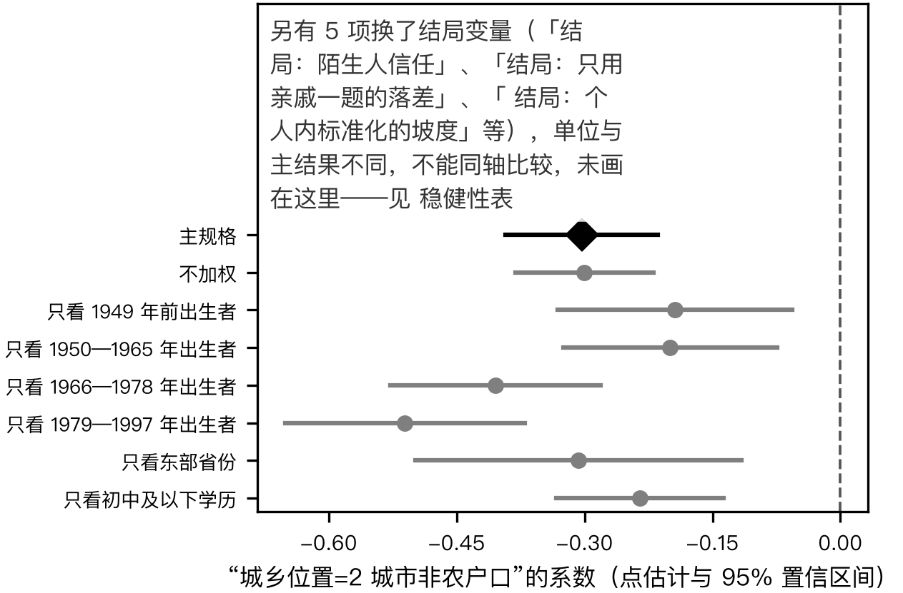
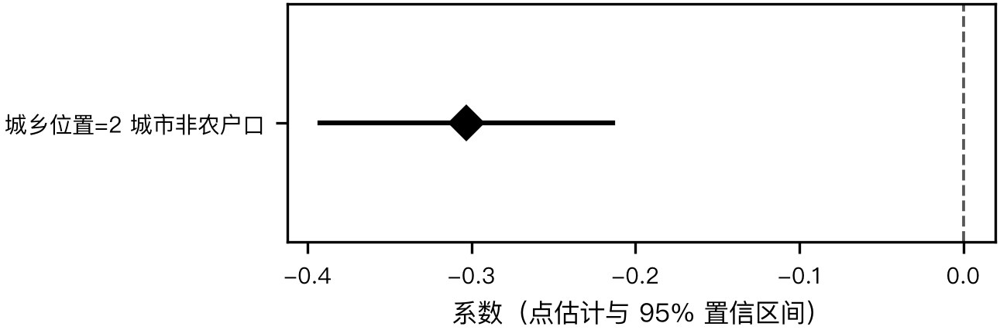

# 差序格局的城乡与代际分布

## 摘要

差序格局在城乡之间、在不同出生年代之间是否一样陡？本文用 2015 年中国综合社会调查，以熟人圈三类对象的信任均值减去对陌生人的信任，度量信任随社会距离递减的幅度。全国加权总体中，城市非农户口居民与农村居民的这一落差相差 -0.303 个作答档次（城市减农村，负值表示城市的落差更小）；出生越晚差距越大，改革开放后出生者为 -0.511。两类居民对陌生人的信任未见明显差别，差距主要出在熟人一端——与农村居民对邻里和同村人的信任较高有关，而非城市居民更信任陌生人。

**关键词**：社会信任；差序格局；信任半径；城乡差异；出生队列

## 一、引言

“中国人信不信任陌生人”这个问题，在国内外文献中有两种互相竞争的回答。一种回答沿着差序格局与信任半径的思路展开：中国人的信任以亲缘和地缘为中心层层外推，对圈外人的信任天然偏低，儒家社会里“大多数人”所指的范围也明显更窄 （翟学伟，2014; Delhey 等，2011）。另一种回答来自现代化理论：经济发展、城镇化与教育扩张会让人更常与陌生人打交道，普遍信任因此上升 （Steinhardt 与 Delhey，2020）。两种回答对当代中国的预测不同——前者预期差序格局在城乡之间大体相同，后者预期它在城市与年轻一代中更平缓。

已有研究为这场争论提供了若干证据，但多数只用一两道题。国际通用的“大多数人可以信任”单题在中国究竟指谁本身就有疑问 （Delhey 等，2011; Steinhardt 等，2024）；按城乡或队列比较信任“半径”的研究 （Zhou 与 Hu，2013），与按年龄—时期—世代分解普遍信任的研究 （GAO 与 Ma，2025），也都没有把熟人一端与陌生人一端分开，看城乡差别究竟落在哪一端。

CGSS 2015 年的问卷就同一题干询问了受访者对十三类对象的信任，从近邻、亲戚一直到陌生人，这在该调查历年问卷中是唯一的一次。**同一批人、同一道题干、同一个五级量表**——这三个条件同时成立，才谈得上比较梯度的两端：题干一换，作答的参照系就变了；人一换，比的就不再是同一个梯度。

本文利用这一机会回答一个描述性问题：信任随社会距离递减的幅度，在城乡位置与出生年代之间是怎样分布的，城乡差别落在梯度的哪一端？本文只描述分布，不对城乡或代际差别作因果解释——城乡位置与出生年代都不是随机分配的，谁住在城市、谁生在哪个年代，本身就与许多别的东西相关，把它们的“后果”与选择效应分开需要另一套设计。

全文的结论可以先说在这里：差序格局在三类居民中都存在，城市一侧略平缓；这一城乡差在较晚出生的人中更大；**而差别几乎全部落在熟人一端，不在陌生人一端**。最后一点是本文与已有研究最不相同的地方，也是它对“中国人是否正在走出差序格局”这场讨论的主要贡献。

## 二、文献与理论

### （一）差序格局与信任的圈层结构

差序格局理论把中国人的社会关系描述为以自己为中心、按亲疏远近推出的同心圆，信任沿圈层递减。这一图景在实证研究中反复出现，但各家测的东西并不一致。胡荣 与 李静雅 (2006) 用城市居民数据把信任分解为特殊信任、一般信任与普遍信任三个成分，三者的水平依次降低，普遍信任最低；祁玲玲 与 赖静萍 (n.d.) 与 阮荣平 与 王兵 (2011) 则直接沿社会距离排列对象，从家人、亲友一路问到陌生人，得到的是一条逐级下降的梯度。两类做法的共同点是把“信任谁”当作一个有结构的问题，而不是一个单一的水平。

这条梯度的两端之间还可能存在此消彼长的关系。陈福平 (2012) 发现，以亲属为核心的关系信任与普遍信任在社会参与的路径上分属两支；Ermisch 与 Gambetta (2010) 用跨国数据给出的结论更直接：家庭纽带越强，对一般人的信任越低。这一思路可以上溯到 Banfield (1959) 对南意大利的观察——他所说的“非道德家族主义”指的正是一个把道德义务限定在家庭之内的社会。翟学伟 (2014) 则从概念上提醒，中文语境里的“信任”本身就兼有对人品的判断与对关系的依赖两层含义，这使得跨圈层的比较比看上去更难。

**但梯度的形状与梯度的水平是两件事。**上述研究多数报告的是各类对象的信任水平，或是某一类对象（通常是“大多数人”）的信任高低；很少有人把梯度本身——从熟人到陌生人落差多大——当作一个量来比较人群。这正是本文要补的那一格。

### （二）差序格局是否正在变化

围绕这一格局是否正在变化，文献分成两派，而两派用的是同一批全国性调查。

悲观的一派把变迁读成失范。Su 等 (2018) 论证经济增长本身会带来规范的真空，普遍信任随之下降；吕炜 等 (n.d.) 用中国综合社会调查的数据发现，人口流入会显著降低流入地居民的社会信任水平，而对外地居民的负向影响更大——按这一支的逻辑，城镇化与流动不是信任的解药，恰恰是病因。

乐观的一派把变迁读成现代化。Steinhardt 与 Delhey (2020) 发现地区现代化程度越高普遍信任越高，而家庭信任与家庭外的特殊信任并不随之变化，据此主张“信任危机”是一个被误读的现象；Steinhardt 等 (2024) 对 1990 年以来多期调查的重新估计更直接地指出，所谓下降在相当程度上是问卷与抽样变动造成的假象；（佚名，n.d.） 对十二个全国性调查的比较也没有发现普遍信任的系统性下滑。

**两派的分歧不只在结论，也在测什么。**悲观的一派多用“大多数人可以信任”这道单题，乐观的一派则强调要把普遍信任与特殊信任分开。而 Delhey 等 (2011) 已经指出，这道国际通用的单题在不同社会里所指的范围并不相同——在儒家社会里，受访者心目中的“大多数人”明显更窄。**如果连这道题指谁都不确定，用它的水平变化去判断差序格局是否松动，结论就悬在测量上。**

### （三）城乡与代际：分歧最集中的两个维度

城乡方面，Zhou 与 Hu (2013) 用“信任半径”这一指标比较城乡人口，发现城市人口的普遍信任半径宽于农村，这是现代化乐观论在中国最常被引用的一条证据；而 Huhe (2013) 的多层分析提醒，农村内部的信任分布本身就很不均衡，把农村当作一个同质的参照本身就有问题。两项研究都以“对一般人的信任”为结局，因而**都无法回答城乡差别究竟落在梯度的哪一端**。

代际方面有两条并行的线索。GAO 与 Ma (2025) 用多轮 CGSS 数据做年龄—时期—世代分解，发现普遍信任在 1975 年后出生的世代中快速下降。另一条线索来自个体化理论：Yan (2010) 论证中国的个体化把人从原有的集体与亲缘纽带中脱出，据此可以预期年轻一代会从熟人网络中脱嵌——若如此，年轻人的熟人信任与陌生人信任应当**同时**向中间收拢，梯度变平。这两条预期的方向一致，但含义不同：前者说的是远端下沉，后者说的是两端靠拢。用单一的普遍信任题，这两种变化看起来是一样的。

### （四）本文要回答的那一格

把上面三支放在一起，有一个很少被分开检验的问题浮出来：**城乡差序格局的不同，是因为城市人更信任陌生人（梯度的远端抬高），还是因为农村人更信任熟人（梯度的近端抬高）？**现代化乐观论讲的是前者——陌生人之间的交往变多，对圈外人的信任随之上升；差序格局与熟人社会的讨论更接近后者——农村的地缘圈仍在承担信任的功能，而城市的邻里关系已经不再承担。

两种机制对同一个“城乡差”给出相同的符号，却指向完全不同的社会过程，而只看普遍信任单题、或只看各类对象的信任水平，都分不开它们。要分开，需要同一批人同时报告梯度的两端，然后**分别**比较两端的城乡差。CGSS 2015 年的问卷恰好提供了这个条件。

本文因此同时报告三个量：熟人信任与陌生人信任之差（本文称之为差序坡度）、陌生人一端各自的城乡差、以及熟人一端换用不同题目时城乡差的变化。**本文只描述这三个量在城乡与出生年代上的分布，不对差别作因果解释**——城乡位置与出生年代都不是随机分配的，本文也不试图把它们的后果与选择效应分开。

## 三、数据与方法

### （一）数据

数据来自中国人民大学中国调查与数据中心执行的 2015 年中国综合社会调查（CGSS 2015）居民问卷。该调查采用多阶分层概率抽样，初级抽样单位为区县。本文使用全部受访者，按调查提供的 `weight` 权重加权，把估计推到 2015 年中国大陆 18 岁及以上住户人口。标准误按抽样设计计算：以区县为初级抽样单位，130 个抽样单位，泰勒线性化；公开数据未提供分层变量，因此未按层计算，区间会略偏宽。只计权重不均的折扣时（Kish 权重设计效应），按 `weight` 加权（取值 0.1629–2.415）。加权有效样本量 7976（实际 10391 行，权重设计效应（Kish）1.30）——**置信区间该按它读，不是按行数**。注意这个数只折算了权重；`oss power` 的有效样本量还折算了整群设计效应，比它更小，两者不可混用；若再计区县整群的折扣，全样本的有效样本量约为 1612，读置信区间时应以后者的量级为准。

样本构建如下：原始：10,968 行 → 去掉回归变量缺失的行：10,391 行 → 估计样本：10,391 行。因结局或分组变量缺失而丢弃的为 577 行（5.3%）。

*表 1. 描述统计。*

| 变量 | N | 均值 | 标准差 | 最小 | 最大 |
|---|---:|---:|---:|---:|---:|
| 差序坡度 | 10391 | 1.891 | 1.093 | -4 | 4 |

::: {custom-style="Table Note"}
*注：*估计样本（样本筛选并去掉缺失之后）。均值与标准差按 weight 加权；N 为未加权的行数。
:::

### （二）变量

**差序坡度**（结局变量）。问卷问：“在不直接涉及金钱利益的一般社会交往/接触中，您觉得下列人士中可以信任的人多不多呢？”每类对象按五级作答，从“绝大多数不可信”到“绝大多数可信”。本文先把“无法回答”“拒绝回答”“不知道”“不适用”四类回答按取值标签设为缺失，再取近邻、远邻或同村居民、亲戚三类对象的均值作为熟人信任（三题须全答），以对陌生人的信任作为陌生人信任，二者之差即差序坡度，取值在负四到四之间，越大表示信任越局限于熟人圈。

理论上的差序坡度是信任沿整条社会距离梯度递减的斜率；本文测的是梯度两端的落差。同事、老同学、同乡、一起参加宗教或业余活动的人等中段对象未纳入，原因是相当一部分受访者生活中没有这类对象，把它们纳入会使指标的样本随对象而变。熟人一端的三题中，“近邻”与“远邻或同村居民”以居住上的邻近为参照，在农村多是亲属与熟人，在城市商品房小区则可能接近陌生人，城乡受访者心目中的对象未必相同；本文因此另报只用“亲戚”一题的落差。

**城乡位置**（分组变量）。结合调查点的城乡属性与受访者户口出身分为三类：农村居民、城市非农户口居民、城市农业户口居民。户口出身按户口登记状况中括号内的原户口类型判定，统一登记为“居民户口”的受访者按其原为农业或非农业户口归类；军籍、没有户口及其他情形设为缺失。调查点城乡属性是行政意义上的城乡，城乡结合部会归入城市。居住在农村而持非农户口的受访者人数很少，按居住地并入农村居民。

**出生年代**。按出生年分为四段：1949 年前、1950—1965 年、1966—1978 年、1979—1997 年，大致对应民国时期、计划经济时期、“文革”至改革前、改革开放后的成长环境。单一年份的横截面里出生年代与年龄完全重合，本文所说的出生年代差别同时包含年龄差别，二者无法分开。

### （三）方法

主结果是三类城乡位置的差序坡度加权均值、95% 置信区间，以及城市两类居民各自与农村居民之差。本文另报以下各项，均按同一权重与抽样设计计算，均取城市非农户口居民与农村居民之差：不加权的估计；四个出生年代各自内部的城乡差；把结局换成陌生人信任、只用亲戚一题的落差、个人内标准化的坡度（差序坡度除以本人在十三类对象上作答的标准差，至少答五题且标准差不为零）、端点作答比例（十三类对象中选“绝大多数不可信”或“绝大多数可信”的比例）、差序坡度是否缺失；以及只看东部省份、只看初中及以下学历两个子样本。除不加权一项外，这些是在初步结果之后为检验几种替代解释而增加的，读者应按探索性的核对来看待。

## 四、结果

*表 2. 差序坡度的分组加权均值（城乡位置）。*

| 组 | N | 均值 | 95% 区间 | 与参照组之差 | p |
|---|---:|---:|---:|---:|---:|
| urban_hukou3=1 农村居民 | 4365 | 2.055 | [1.983, 2.127] | 参照 | 参照 |
| urban_hukou3=2 城市非农户口 | 3527 | 1.752 | [1.679, 1.824] | -0.303*** | <0.001 |
| urban_hukou3=3 城市农业户口 | 2499 | 1.820 | [1.742, 1.899] | -0.235*** | <0.001 |

::: {custom-style="Table Note"}
*注：*分组均值与比例。 标准误按抽样设计算（未分层，初级抽样单位 county，泰勒线性化）。 按 weight 加权。 \* p < 0.10，\*\* p < 0.05，\*\*\* p < 0.01。 组间差以排序后的第一组为参照。
:::

表 2 是本文的主要结果。**三类居民的差序坡度都在一到两个作答档次之间，没有任何一类接近于零**——就 2015 年的这批数据而言，信任随社会距离递减是一个普遍现象，不是某一类人群的特征。差序格局是否存在，在这份数据上不是一个有争议的问题；有争议的是它在人群之间陡不陡。

城市非农户口居民与农村居民之差为 -0.303（标准误 0.045），负值表示城市一侧的落差更小。放到量表上读：这个差相当于熟人与陌生人之间的落差在城市比在农村少了约三成之一到三分之一个作答档次——**不是量级上的差别，而是同一个陡峭梯度上的一点松动**。城市农业户口居民（主要是乡城流动人口）落在两者之间，与“居住在城市但户籍在农村”这一处境相符，但本文未对这一群体单独作推断。

读这些区间时要注意，按抽样设计计算之后，全样本的有效样本量约为 1612，明显小于行数；分组之后每一格的有效样本量更小（见 分组的有效样本量按抽样设计算（样本量 ÷ 设计效应）：设计效应 = 这一格的方差 ÷ 同样本量简单随机抽样的方差（Kish 的定义；NCHS 的比例标准用同一个有效样本量），整群与权重的折扣都在里面，封顶在这一格的 Kish 有效样本量。跟环节 4 同一个概念（样本量 ÷ 设计效应）；环节 4 是事前按假定的组内相关算的，这里是按实际的设计标准误算的，两者可以不同。分组表不列它，小格判据（small_cells）读它）。区间的宽度要按这个量级理解，而不是按样本行数理解。

*表 3. 各项复核（均为城市非农户口居民减农村居民之差）。*

| 规格 | 结局 | 估计值 | 标准误 | p | MDE | 样本量 |
|---|---|---:|---:|---:|---:|---:|
| 主规格 | 差序坡度 | -0.303*** | 0.045 | <0.001 | 0.128 | 10391 |
| 不加权 | 差序坡度 | -0.300*** | 0.041 | <0.001 | 0.115 | 10421 |
| 只看 1949 年前出生者 | 差序坡度 | -0.194*** | 0.069 | 0.006 | 0.196 | 2097 |
| 只看 1950—1965 年出生者 | 差序坡度 | -0.200*** | 0.064 | 0.002 | 0.179 | 3267 |
| 只看 1966—1978 年出生者 | 差序坡度 | -0.404*** | 0.062 | <0.001 | 0.176 | 2601 |
| 只看 1979—1997 年出生者 | 差序坡度 | -0.511*** | 0.071 | <0.001 | 0.200 | 2426 |
| 结局：陌生人信任 | 陌生人信任 | 0.031 | 0.051 | 0.538 | 0.143 | 10704 |
| 结局：只用亲戚一题的落差 | 亲戚—陌生人落差 | -0.122** | 0.053 | 0.024 | 0.151 | 10675 |
| 结局：个人内标准化的坡度 | 个人内标准化的差序坡度 | -0.230*** | 0.042 | <0.001 | 0.120 | 10026 |
| 结局：端点作答比例 | 端点作答比例 | -0.030*** | 0.009 | 0.001 | 0.026 | 10854 |
| 结局：差序坡度缺失 | 差序坡度缺失 | 0.047*** | 0.009 | <0.001 | 0.025 | 10916 |
| 只看东部省份 | 差序坡度 | -0.307*** | 0.095 | 0.002 | 0.272 | 4067 |
| 只看初中及以下学历 | 差序坡度 | -0.235*** | 0.050 | <0.001 | 0.140 | 6886 |

::: {custom-style="Table Note"}
*注：*分组均值与比例。 标准误按抽样设计算（未分层，初级抽样单位 county，泰勒线性化）。 按 weight 加权。 \* p < 0.10，\*\* p < 0.05，\*\*\* p < 0.01。

MDE = 该规格**能分辨的最小差异**（双侧、80% 功效）。系数贴近零而 MDE 很宽，说明这一项**测不出**效应，不等于效应不存在。

注：其中 5 项换了结局变量，**单位与主结果不同，系数不可直接比较**。
:::

**出生年代。**城乡差在每个出生年代内部都存在，**并且单调地随出生年代变大**——这一点比城乡差本身更值得注意，因为它意味着城乡之间的这道裂缝不是在弥合而是在扩大。四个出生年代的城乡差依次为：1949 年前出生者中为 -0.194，1950—1965 年出生者中为 -0.200，1966—1978 年出生者中为 -0.404，1979—1997 年出生者中为 -0.511。换言之，**较平缓的差序格局集中在城市本地较年轻的人身上**，而 1949 年前出生的城乡居民之间几乎没有这道裂缝。

需要立刻说明的是，单一年份的横截面里出生年代与年龄完全重合，这条单调的趋势既可以读成“后来的世代不同”，也可以读成“年轻时落差本来就小、老了会变陡”。两种读法在本数据上分不开（见局限）。但无论哪一种读法，“城乡差集中在年轻一代”这个描述本身都成立——而这恰恰与GAO 与 Ma (2025) 报告的“普遍信任在 1975 年后世代中快速下降”构成一个值得注意的对照：那一支看到的是远端下沉，本文看到的是城乡分化，两者未必矛盾，但不能互相替代。

**城乡差落在梯度哪一端。**把结局换成陌生人信任，城市非农户口居民与农村居民之差为 0.031（标准误 0.051），区间包含零。这说明本文没有发现城乡居民对陌生人的信任有差别，但区间的宽度不足以排除一个有意义大小的差别，不能据此断言二者相同；差序坡度的城乡差主要出在熟人一端。只用“亲戚”一题衡量熟人信任时，城乡差缩小到 -0.122，不到三题合并时的一半。换言之，去掉“近邻”“远邻或同村居民”两题后，城乡差大部分消失；本文没有对这两题分别估计，因此说不出两题各占多少。

**作答风格。**城乡差还有一种与信任无关的解释：两类居民使用量表的方式不同。若农村受访者更倾向于选择两端（“绝大多数不可信”或“绝大多数可信”），他们的差序坡度就会机械地更大，而这与他们实际信任谁无关。本文用两项检查回应这一条。其一，城市非农户口居民选择量表两端的比例确实略低于农村居民，差为 -0.030（比例之差）——**作答风格的差别是存在的**。其二，把差序坡度按本人在十三类对象上作答的标准差标准化，即扣掉个人使用量表的分散程度之后，城乡差为 -0.230（单位是本人作答的标准差，不能与原量表的数值直接比较），**方向不变**。因此作答风格解释不了全部城乡差，但本文也没有量出它解释了多少。

**缺失。**差序坡度缺失的概率在两类居民之间也有差别（0.047）。这说明进入分析的样本在城乡之间的可比性本身就打了折扣，而本文报告的是完整作答者的分布。

**地区与学历。**只看东部省份时城乡差为 -0.307，只看初中及以下学历者时为 -0.235，城乡差在这两个子样本中都存在。这只说明城乡差不全是东中西部之别或学历之别，不说明城乡位置本身带来了这些差别。不加权的估计为 -0.300，与加权估计接近。

*图 1. 城市非农户口居民减农村居民的差序坡度之差：主规格与同单位各项复核的点估计与 95% 置信区间（换结局的各项单位不同，未画入，见表 3）。*

*图 2. 主规格的点估计与 95% 置信区间。*

## 五、讨论

### （一）发现对两派理论意味着什么

本文的发现对两派理论都提出了问题。现代化乐观论预期城市人更信任陌生人，但在 2015 年的数据里，本文没有发现城市非农户口居民对陌生人的信任高于农村居民；城乡差序格局的不同，更多出在熟人一端，并且集中在邻里与同村人两题上。一种解读接近熟人社会论的图景：农村的“地缘”圈仍是信任的来源，而城市的邻里关系已不再承担这一角色。另一种解读是测量上的：农村的邻里、同村人往往就是亲族，城市的邻居则多是陌生人，两题在城乡量的本就不是同一种关系。本文的数据分不开这两种解读。城乡差在较晚出生者中更大，与这一解读相容——较年轻的城市居民更可能住在商品房小区、与邻居不相识——但由于单一横截面分不开年龄与出生年代，这些差别同样可能是生命周期的差别。

城市农业户口居民——主要是乡城流动人口——的差序坡度落在农村居民与城市非农户口居民之间。这一位置与两种机制都相容：他们既可能因为身处城市而邻里关系疏离（近端下沉），也可能因为流动而与陌生人打交道更多（远端抬高）。已有研究多只看普遍信任单题 （吕炜 等，n.d.），因而分不开这两条；本文也没有直接比较这一群体与城市本地人，二者在梯度两端各差多少，留待进一步分析。

### （二）对测量社会信任的含义

本文最稳的一条发现其实是方法上的：**城乡差序格局的差别几乎全部出在熟人一端，而且集中在“近邻”“远邻或同村居民”两题上**——只用“亲戚”一题时，城乡差缩小到 -0.122，不到三题合并时的一半。

这对怎么测信任有直接含义。**“邻居”这个词在城乡指的不是同一种关系。**在农村，邻居往往同时是亲族、同村人、几十年的熟人；在城市商品房小区，邻居可能是一个只在电梯里见过的人。把“对邻居的信任”当作一个跨城乡可比的量，等于假定这个词在两边指向同一类对象，而这个假定在本数据上就站不住。

这一点与 Delhey 等 (2011) 对“大多数人”那道题的批评是同一类问题的两个例子：**用同一个词问不同人群，得到的未必是同一个量。**差别在于，“大多数人”的模糊是公认的，而“邻居”看上去具体、似乎不需要额外说明。按本文的结果，它同样需要。

**因此，比较人群的信任水平之前，先要问这些题目在各人群里指的是不是同一批人。**这一条不只对城乡比较成立；跨国比较、跨代比较都面临同样的问题。

### （三）怎么读“走出差序格局”

公共讨论里常把“中国人开始信任陌生人”与“中国人不再那么依赖熟人”当作一回事。本文的结果说明这两件事在数据上是分开的：**城乡之间的差别落在后者，而不是前者。**城市非农户口居民与农村居民在对陌生人的信任上没有检出差别（0.031，区间包含零），差的是熟人那一端。

如果这个模式在别的年份、别的数据上也成立，那么“走出差序格局”在当代中国更接近**熟人圈的收缩**，而不是**信任半径的扩张**。这两种过程的社会含义不同：前者意味着原有的信任来源在退，而新的尚未接上；后者才是通常所说的现代化图景。本文只有一年的横截面，不能判断哪一种正在发生，但可以说：**把两者混为一谈的讨论，在这份数据上得不到支持。**

### 局限

第一，精度。本文事先设定的有意义的最小差别约为十分之一个作答档次。主比较的标准误为 0.045，其 95% 区间的半宽约为两个标准误，接近这一有意义的最小差别，精度处在临界区间；单一出生年代内部的比较样本只有全样本的四分之一左右，区间更宽，年代之间城乡差的大小排序应谨慎解读。表 2 与表 3 的各项比较都是未作多重比较校正的逐项比较，年代之间城乡差的差别也未作正式的等同性检验。

第二，年龄与出生年代无法分开。单一横截面里二者完全重合，本文所说的“较晚出生者城乡差更大”同样可以读作“较年轻者城乡差更大”。要分开二者需要多轮数据，而 CGSS 历年问卷中完整的十三类对象信任题只在 2015 年出现过。最年长的一组还带有存活与健康状况的选择：活到 2015 年并能接受访问的 1949 年前出生者，未必代表那一代人。

第三，测量。差序坡度只取梯度两端，不是完整的斜率。熟人一端的“近邻”“远邻或同村居民”两题在城乡之间所指的对象可能不同，城乡差有一大半落在这两题上——这一部分既可以读作农村邻里信任更高，也可以读作两题在城乡量的不是同一种关系，本文无法区分。作答风格能解释城乡差的一小部分；本文未检验十三类对象信任量表的跨组测量等价，城乡均值的直接比较以测量等价为前提。

第四，样本可比性。差序坡度要求熟人三题与陌生人一题都有实质回答。城市非农户口居民不满足这一条件的比例明显高于农村居民，差为 0.047（比例之差）；若城市里缺答的人更少依赖邻里关系，进入结局的城市样本会偏向邻里信任较高的人，城乡差会被低估，但本文无法验证缺答者的情形。

第五，分组的处理。城乡位置三分类由居住地 × 户口出身四分类合并而来：居住在农村而持非农户口的受访者人数很少，并入了农村居民；改用四分类时其余三格完全相同，只有这一格的并入会使农村组的受教育程度略偏高。城乡位置同时与学历、收入、职业、地区发展纠缠在一起，本文只在东部省份与低学历两个子样本中核对，不对这些因素作调整，所报告的是未经去杂的城乡差。

第六，按总调查误差的五类逐一交代。抽样误差：区间按区县整群与权重计算，但公开数据未提供分层变量，区间略偏宽。覆盖误差：调查覆盖中国大陆住户人口，不含集体户与无固定住所者，这部分人群中流动人口比例较高，城市农业户口一组的代表性因此可能不足；本文无法评估其大小。无应答误差：单位无应答由调查权重调整，但本文未能取得权重校准所用维度的说明，学历是否参与校准不明；若未参与，而学历又同时与信任和城乡位置相关，残余偏差的方向无法判断。题项无应答见第四条。测量误差见第三条。加工误差：缺失码按取值标签剔除、户口与学历按标签重编码，每一步的依据写在构造变量的脚本注释中；收入题存在未标注的疑似编码，本文未使用收入变量。样本的城乡构成未与官方公布的 2015 年常住人口城镇化率、户籍人口城镇化率对照；若调查的城乡构成与总体有偏差，合并各类居民的总体均值会随之偏移，分组均值不受影响。

第七，文献覆盖。英文文献来自结构化学术数据库，精读的英文文献多数只能读到摘要，与本文最接近的一项研究 （Zhou 与 Hu，2013） 未读到全文，本文不主张比它新。中文文献方面，结构化数据库中的中文核心期刊记录只覆盖到 2018 年前后，以“社会信任 城乡”为检索式在其中没有命中任何记录；中文文献主要来自网页检索下载的开放全文，由模型提供检索候选，不是系统性检索，同一检索式在不同时间结果可能不同，不可完全复现。因此，近年中文期刊上以城乡信任结构为题的研究可能有遗漏。

### 尚未解决的问题

第一，熟人一端两道邻里题各自的城乡差。本文只做了“去掉两题、只留亲戚”这一种拆法，没有分别估计“近邻”与“远邻或同村居民”两题的城乡差，也没有报告各题在各组中的“不适用”比例。这用现有数据可以做到：逐题重估城乡差，并按城乡位置 × 出生年代列出逐题的缺答率。

第二，亲族与邻里的重叠。在农村，邻居与同村人常常就是亲属，三题取均值可能把亲族信任计入不止一次，使农村的熟人一端偏高。CGSS 不问受访者的邻居中有多少是亲属，现有数据无法分开这一点；需要能识别邻里中亲属比例的社会网络数据。

第三，跨组测量等价。城乡与出生年代之间的均值比较以十三类对象信任题的测量等价为前提。本文没有做多组验证性因子分析；要做，需要对十三题建模，逐步检验载荷与截距在各组之间是否相等。

第四，学历与地区的纠缠。本文只在低学历与东部两个子样本中核对，没有按学历匹配城乡居民，也没有在每个出生年代内部分地区核对。较晚出生的城市非农户口居民可能更集中在东部大城市，出生年代之间的城乡差梯度可能部分来自地区构成的差别。现有数据可以做出生年代 × 地区的交叉核对，但每格样本会很小。

第五，户籍改革后的归类。2014 年以后统一登记为“居民户口”的受访者，本文按其自报的原户口类型归类；这一归类的误差若随出生年代变化，会影响出生年代之间城乡差的形状。要排除这一点，可以把这部分受访者单列一类，或只用登记状况没有歧义的受访者重估。

第六，缺答随出生年代的变化。城市非农户口居民的缺答率高于农村居民，但本文没有按出生年代拆开，也没有对缺答者作上下界估计。最年轻一组的城乡差若建立在筛选最强的样本上，其大小会被高估或低估，方向不明。

第七，农村较年轻者的留守选择。2015 年仍住在农村的较年轻者，是同龄人中没有流入城市的那一部分，他们对村庄网络的依赖可能更强，这会放大最年轻一组的城乡差。要检验这一点，需要带有迁出者信息的数据，例如追踪同一批农村青年的面板调查。

第八，等同性判断。“未发现城乡居民对陌生人的信任有差别”“城乡差在出生年代之间大小不同”这两种说法都没有做正式的等同性检验或差异检验；要下更强的结论，需要事先设定等同性边界并做双单侧检验。

第九，年龄与出生年代的分离。需要至少两轮问过同一组对象信任题的调查。CGSS 2005 年问卷中有八类对象与 2015 年相同，可以据此做两轮比较，这是本文之外最直接的延伸。

第十，外部核对。加权样本的城镇居住比例与非农户口比例，尚未与官方公布的 2015 年常住人口城镇化率、户籍人口城镇化率比对。

## 六、结论

在 2015 年的中国，信任从熟人到陌生人的落差普遍存在，三类居民无一例外。城市非农户口居民的落差小于农村居民，这一城乡差在较晚出生的人中更大，且在四个出生年代之间单调上升。

但城乡差的位置比它的大小更值得注意：**本文没有发现两类居民对陌生人的信任有差别，差别主要出在熟人一端，尤其是邻里与同村人两题**——只用“亲戚”一题时，城乡差缩小到不足一半。而“邻居”这个词在城乡所指的关系可能本就不同：在农村多是亲族与几十年的熟人，在城市可能只是同一栋楼里见过面的人。本文的数据分不开“信任的对象变了”与“同一个词指的人变了”这两种解释。

由此得到两条结论。**对这场讨论而言**，“中国人开始信任陌生人”与“中国人不再那么依赖熟人”是两件事，在这份数据上分得开，而且答案不同——把它们混在一起谈，得到的结论在本数据上得不到支持。**对测量而言**，比较人群的信任水平之前，先要问这些题目在各人群里指的是不是同一批人；“大多数人”那道题的模糊是公认的，“邻居”看上去具体，按本文的结果同样需要说明。

要把这两条推进一步，需要的是在同一份问卷里同时问“对象是谁”与“有多信任”，或者在多个年份重复这一组十三类对象的题目——后者能把年龄与出生年代分开，而这正是本文用单一横截面做不到的事。

## 参考文献

- [NO AUTHOR]（n.d.）。[UNVERIFIED] 变迁社会中的社会信任：存量与变化.
- Edward C. Banfield（1959）。The Moral Basis of a Backward Society.. DOI: 10.2307/2550413
- Jan Delhey、Kenneth Newton、Christian Welzel（2011）。How General Is Trust in “Most People”? Solving the Radius of Trust Problem. DOI: 10.1177/0003122411420817
- John Ermisch、Diego Gambetta（2010）。Do strong family ties inhibit trust?. DOI: 10.1016/j.jebo.2010.05.007
- Xuede GAO、Haihong Ma（2025）。Changing trends of Chinese people's generalized trust: A dynamic analysis of the age-period-cohort effect. DOI: 10.3724/sp.j.1041.2025.0463
- Narisong Huhe（2013）。Understanding the Multilevel Foundation of Social Trust in Rural China: Evidence from the China General Social Survey. DOI: 10.1111/ssqu.12049
- H. Christoph Steinhardt、Jan Delhey（2020）。Socio-Economic Modernization and the “Crisis of Trust” in China: A Multi-level Analysis of General and Particular Trust. DOI: 10.1007/s11205-020-02466-w
- H. Christoph Steinhardt、Xue Gong、Jan Delhey（2024）。Chasing a phantom: a re-evaluation of China’s “trust crisis”. DOI: 10.1080/21620555.2024.2430265
- Zhenhua Su、Yanyu Ye、Pu Wang（2018）。Social change and generalized anomie: Why economic development has reduced social trust in China. DOI: 10.1177/0268580918812281
- Yunxiang Yan（2010）。The Chinese path to individualization. DOI: 10.1111/j.1468-4446.2010.01323.x
- Yi Xin Zhou、Anning Hu（2013）。The Radius of Generalized Trust in Contemporary China. DOI: 10.2753/csa2162-0555460203
- 吕炜、姬明曦、杨沫（n.d.）。[UNVERIFIED] 人口流动能否影响社会信任.
- 祁玲玲、赖静萍（n.d.）。[UNVERIFIED] 信任的差序格局与民主价值.
- 翟学伟（2014）。信任的本质及其文化.
- 胡荣、李静雅（2006）。城市居民信任的构成及影响因素.
- 阮荣平、王兵（2011）。差序格局下的宗教信仰和信任——基于中国十城市的经验数据.
- 陈福平（2012）。市场社会中社会参与的路径问题——关系信任还是普遍信任.

## Abstract

**The Urban–Rural and Generational Distribution of the Differential Mode of Trust in China**

Whether the Chinese "differential mode of association" in trust is equally steep across urban and rural China and across birth cohorts is a central question for understanding social trust in contemporary China. Using the 2015 Chinese General Social Survey, we measure the gap between trust in acquaintances and trust in strangers. In the weighted national population, the gap among urban residents with non-agricultural hukou differs from that among rural residents by -0.303 response categories (negative values mean smaller), and the urban–rural difference is larger in later-born cohorts, reaching -0.511 among those born after the reform era began. We find no urban–rural difference in trust in strangers; the difference lies mainly at the acquaintance end, and it shrinks to -0.122 when acquaintance trust is measured by trust in relatives alone. The urban–rural contrast is associated more with rural residents' higher trust in neighbours and fellow villagers than with greater trust in strangers among urban residents, although neighbours and fellow villagers may denote different relationships in urban and rural settings.

**Keywords:** social trust; differential mode of association; radius of trust; urban–rural differences; birth cohort
