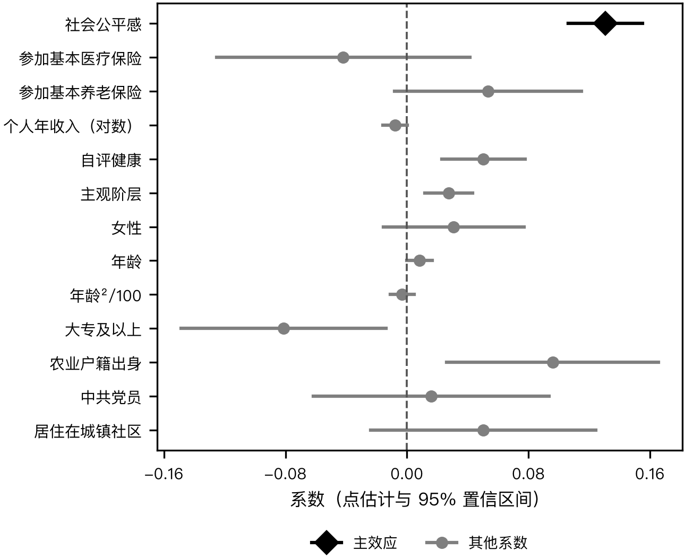
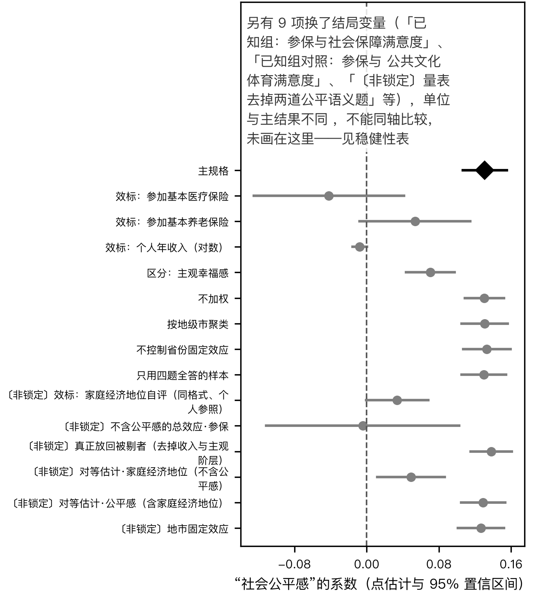

# 公共服务获得感测的是谁的获得

## 摘要

“获得感”被界定为民众从民生公共服务中实际得到之后的感受，而全国性调查里常用来测它的，是受访者对“我国目前公共服务总体”充足、均衡、便利、普惠程度的评价。本文用中国综合社会调查 2013 年数据，检验这套四题量表更接近本人得到的东西，还是对社会整体的判断。同一省份内，社会公平感每高一级，量表分高 0.131 分（五分制）；参加基本医疗保险与个人收入对应的差别为 -0.042 与 -0.008，未检出正向关联；养老保险为 0.053，精度不足以与公平感区分。这一对比不只是“主观效标对客观效标”：换一个同为五级自评、**只把参照层次改为自己家**的效标，对等规格上系数为 0.049，公平感为 0.129——两者都不为零，后者大出约一倍半到两倍。量表因此更接近对社会整体的判断，不宜把总体题当作个人获得的尺度来比较人群。

**关键词**：获得感；公共服务评价；测量效度；社会取向评价；中国综合社会调查

## 一、引言

“让人民群众有更多获得感”提出之后，获得感很快成为评价民生政策的常用尺度。它与幸福感、满意度的区别被反复强调：获得感落脚在“得到”，是建立在客观获得之上、对客观获得的主观感受 （阳义南，2018）。这一界定决定了测量应当指向个人——指向“我从教育、医疗、社会保障中得到了什么”。

然而全国性数据里最系统的一次测量，走的是另一条路。阳义南 (2018) 使用中国综合社会调查 2013 年数据，以受访者对“我国目前公共服务总体上”资源充足、分布均衡、获取便利、普惠程度的四道评价题作为获得感的指标，得到单一因子，并据此比较省份与人群。这四道题评价的对象是国家的公共服务体系，而不是受访者本人得到的服务。两者的差别并非措辞之争：政治心理学早已区分对社会整体状况的评价与对自身处境的评价，前者受政治态度与一般信念的牵引，后者才与个人的实际所得相连。公共管理中关于公民满意度的研究也表明，主观评价与客观供给往往对不上，评价受期望与参照点的左右 （Stipak，1979; Ryzin，2004; Zhang 等，2021）。如果获得感量表测到的主要是对社会整体的判断，那么以它比较人群、评估政策，得出的就不是“谁得到得多”，而是“谁对社会看法更正面”。

本文检验的正是这一点：这套四题量表更接近自我取向的“得到”，还是社会取向的整体判断。检验不涉及因果，而是测量效度中的效标关联与区分证据——量表分与本人实际获得（参保、收入）的关联，对比它与社会公平感这一社会取向判断的关联；再以已知组的逻辑检查分领域评价题能否分辨参保与未参保的人。

本文的贡献有两点。第一，为一套已被用来比较人群的获得感量表补上效度证据，说明它更适合解读为对公共服务体系的总体评价。第二，指出若要测量个人层面的获得，分领域、可对应到具体所得的评价题比总体题更合适。已有研究或以这套量表直接比较人群 （阳义南，2018），或把公共服务满意度作为已知构念放入模型 （Zhou 等，2021），都没有检验它指向个人还是社会整体。

## 二、文献与理论

### （一）获得感的界定与测量

获得感是有中国特色的新概念。概念讨论普遍把它与幸福感区分开：获得感强调实实在在的得到，包括物质与精神两个层面 （阳义南，2018）。心理学路线的专门量表把获得感分为认知与情感体验两部分，但样本限于城市社区居民 （王艳丽 与 陈红，2021）；专门调查则把获得感拆成项目重要性、当前获得与未来预期等侧面 （谭旭运 等，2018）。这些工作都说明获得感是多维的，且核心在个人层面的所得。

全国代表性数据上的测量，以 阳义南 (2018) 最为系统。该研究批评早先的测量把“获得”与“获得感”混为一谈，主张用多指标潜变量测后者，选中的正是上述四道总体评价题；而作为“获得”一侧的八个领域评分，同样是受访者的主观打分。这一设计留下两处未检验的地方：总体题是否指向个人，以及同一受访者两组主观评价之间的关联有多少来自共同的作答倾向。

### （二）社会取向评价与自我取向评价

对公共事务的评价可以指向社会整体，也可以指向自身。对社会整体的评价更多由政治信念、对政府的一般信任与社会公平观塑造，与个人境况的关联较弱；对自身的评价则应随个人实际所得变化。公共服务满意度研究中的期望不一致理论给出了相近的提醒：满意度不是服务绩效的直接读数，而是绩效与期望之差的函数，期望本身又受社会参照点影响 （Ryzin，2004; Ryzin，2013）。主观评价与客观绩效的连接一直存在争议，早期研究就警告不宜把满意度直接当作绩效指标使用 （Stipak，1979; Parks，1984）；政府满意度的综述也指出，外显的满意度测量受社会称许性与一般态度影响 （贾奇凡 等，2018）。

由此推出本文的检验逻辑。若四题量表测的是个人获得，它应当与参保、收入等个人实际所得相关，且在控制这些所得之后与社会公平感的关联应当有限；若它测的是社会取向的整体判断，则应当与社会公平感紧密相关，而与个人所得几乎无关。

### （三）跨群体比较的前提

以量表分比较城乡、户籍或学历群体，还有一个前提：量表在各群体中量的是同一个东西。比较公共管理研究已经表明，不检验测量等价就比较群体均值，排序可能被颠倒 （Jilke 等，2015）；锚定情境法也显示不同人群对同一满意度刻度的理解不同 （孙宗锋，2018）。有研究报告中国城乡样本的福利满意度指标在载荷与截距层面等价 （Xu 等，2025），但那是另一套指标。本文不检验四题量表的跨群体等价，因此也不对群体间的量表分高低下结论。

## 三、数据与方法

### （一）数据与抽样设计

数据来自中国综合社会调查 2013 年（CGSS2013），覆盖 28 个省级单位，共 11438 名受访者。该年问卷把公共服务评价放在 C 卷，由随机分到 C 卷的约一半受访者回答，另一半回答 D 卷；两卷的受访者互不重叠。本文分析 C 卷受访者。

CGSS 第二期采用多阶段分层概率抽样：以 100 个县级单位加北京、上海、天津、广州、深圳五个大城市为初级抽样单位，市辖区与县分别分层。公开数据没有分层变量，本文的标准误按初级抽样单位做泰勒线性化，不分层。初级抽样单位由区县编码构造，北京、上海、天津按整市合并；广州、深圳在公开数据中无法识别，仍按区县计，共得到 106 个抽样单位。所有估计按数据自带的个人权重加权，同时报告不加权的结果；权重不均会降低有效样本量，本文的置信区间与最小可探测效应都按抽样设计与权重计算。

### （二）变量

**获得感量表**。四道题询问受访者对“我国目前公共服务总体上”四个方面的满意程度：资源的充足程度、资源分布的均衡程度、获取的便利程度、普惠性程度，均为 1（非常不满意）至 5（非常满意）。拒绝回答、不知道、不适用改为缺失。至少答了三题的受访者取有效题的均值作为量表分（1–5）；只答两题及以下的不计分。理论上获得感要的是个人实际得到之后的感受；这四题测的是对国家公共服务体系的评价；二者的差距在于题目的指向，这正是本文要检验的，而不是事先可以修正的误差。

**社会取向效标**。社会公平感取“总的来说，您认为当今社会公不公平”，1（完全不公平）至 5（完全公平）。它是单题测量，信度较低会使其与量表的关联偏小；而它与量表同为同一受访者的主观评价，共同方法方差又会使关联偏大。

**自我取向效标**。是否参加基本医疗保险（城镇职工或居民医保、新农合、公费医疗）与基本养老保险，参加为 1、未参加为 0，标签为“不适用”的回答改为缺失；个人 2012 年总收入取对数（收入加一后取对数），不适用、不知道、拒绝回答以及“高于百万位数”的顶码改为缺失。参保只是“得到”的一个侧面，2013 年基本医保覆盖已很广，变异集中在少数未参保者，这会使参保与量表的关联偏小。辅以自评健康（1–5）与主观阶层（1–10）。

**区分效度参照**。主观幸福感取“总的来说，您觉得您的生活是否幸福”，1–5。用它检验量表是否只是一般的积极作答倾向。

**已知组检验**。领域评价取受访者对社会保障与公共文化体育两个领域的满意度（0–100）。“至少参加一项基本社会保险”为 1，两项都未参加为 0。

**控制变量**。女性；年龄（2013 减出生年）及年龄平方除以 100；大专及以上学历（大学专科、本科含成人教育、研究生为 1，其余学历为 0，学历“其他”改为缺失）；农业户籍出身（农业户口与“居民户口（以前是农业户口）”为 1，非农、蓝印、“居民户口（以前是非农业户口）”、军籍为 0，无户口与其他改为缺失）；中共党员；居住在居委会（城镇社区）。

表 1 报告各变量的描述统计。

*表 1　描述统计*

| 变量 | N | 均值 | 标准差 | 最小 | 最大 |
|---|---:|---:|---:|---:|---:|
| 公共服务获得感 | 4942 | 3.007 | 0.709 | 1 | 5 |
| 社会公平感 | 4942 | 3.020 | 1.045 | 1 | 5 |
| 参加基本医疗保险 | 4942 | 0.898 | 0.302 | 0 | 1 |
| 参加基本养老保险 | 4942 | 0.715 | 0.452 | 0 | 1 |
| 个人年收入（对数） | 4942 | 8.725 | 3.039 | 0 | 13.816 |
| 自评健康 | 4942 | 3.668 | 1.092 | 1 | 5 |
| 主观阶层 | 4942 | 4.287 | 1.701 | 1 | 10 |
| 女性 | 4942 | 0.490 | 0.500 | 0 | 1 |
| 年龄 | 4942 | 51.310 | 16.647 | 17 | 97 |
| 年龄²/100 | 4942 | 29.098 | 17.329 | 2.890 | 94.090 |
| 大专及以上 | 4942 | 0.167 | 0.373 | 0 | 1 |
| 农业户籍出身 | 4942 | 0.573 | 0.495 | 0 | 1 |
| 中共党员 | 4942 | 0.111 | 0.314 | 0 | 1 |
| 居住在城镇社区 | 4942 | 0.632 | 0.482 | 0 | 1 |

::: {custom-style="Table Note"}
*注：*估计样本（样本筛选并去掉缺失之后）。均值与标准差按 weight 加权；N 为未加权的行数。
:::

另构造三列，用于第四节的对照检验：家庭经济状况档次（1–5 的五级自评，参照层次是本人家庭而非社会整体，用作同格式的个人参照效标）；去掉“分布均衡”“普惠程度”两道公平语义题之后、只由“资源充足”与“获取便利”合成的量表；以及“两个已知组领域都作答”的指示变量。三列的构造式与缺失码处理与上文各列相同。

本文的估计样本为 按 `weight` 加权（取值 0.1673–3.676）。加权有效样本量 3511（实际 4942 行，权重设计效应（Kish）1.41）——**置信区间该按它读，不是按行数**。注意这个数只折算了权重；`oss power` 的有效样本量还折算了整群设计效应，比它更小，两者不可混用，区间应按其中的加权有效样本量读，不是按行数。

### （三）估计

主规格是以量表分为结果、社会公平感为主要解释变量的加权线性回归，同时放入全部自我取向效标与控制变量，并以省份固定效应吸收省际差异，即只在同一省份内比较。系数是条件关联，不作因果解释：它回答的是在个人实际所得与人口学特征相同的人之间，公平感不同的人量表分差多少。自我取向效标的系数来自同一模型。区分效度的检验在主规格上再放入主观幸福感。已知组检验另以社会保障、公共文化体育两个领域评价为结果，以是否参保为解释变量，只控制人口学特征与省份。

分析样本为 C 卷中量表有分、且各变量不缺失的受访者（4942 人）。全样本中因缺失而未进入的行主要来自分卷设计——D 卷受访者没有回答公共服务题；C 卷内部另有一部分受访者因收入等变量缺失未进入（原始：11,438 行 → 去掉回归变量缺失的行：4,942 行 → 估计样本：4,942 行）。

## 四、结果

### （一）量表与社会取向、自我取向效标的关联

表 2 报告主规格。社会公平感与量表分的关联最强：同一省份内，个人所得与人口学特征相同的人中，公平感每高一级，量表分高 0.131 分（标准误 0.012，p < 0.001）。按公平感的全距计，最低与最高者之间的量表分差距约为量表的半个等级。

*表 2　获得感量表的效标关联（加权最小二乘，省份固定效应）*

| 变量 | 估计值 | 标准误 | p |
|---|---:|---:|---:|
| 社会公平感 | 0.131*** | 0.012 | <0.001 |
| 参加基本医疗保险 | -0.042 | 0.042 | 0.320 |
| 参加基本养老保险 | 0.053* | 0.031 | 0.088 |
| 个人年收入（对数） | -0.008* | 0.004 | 0.058 |
| 自评健康 | 0.050*** | 0.014 | <0.001 |
| 主观阶层 | 0.028*** | 0.008 | <0.001 |
| 女性 | 0.031 | 0.023 | 0.189 |
| 年龄 | 0.008* | 0.004 | 0.052 |
| 年龄²/100 | -0.003 | 0.004 | 0.430 |
| 大专及以上 | -0.081** | 0.034 | 0.019 |
| 农业户籍出身 | 0.096*** | 0.035 | 0.007 |
| 中共党员 | 0.016 | 0.039 | 0.682 |
| 居住在城镇社区 | 0.050 | 0.037 | 0.182 |
| 样本量 | 4942 |  |  |
| 固定效应 | province |  |  |

::: {custom-style="Table Note"}
*注：*OLS + 固定效应。 固定效应：province。 标准误按抽样设计算（未分层，初级抽样单位 psu，泰勒线性化）。 按 weight 加权。 \* p < 0.10，\*\* p < 0.05，\*\*\* p < 0.01。
:::

自我取向效标的关联则弱得多。需要说明，公平感是五级自评，参保是 0/1 变量，收入是对数，三者量纲不同，系数不能直接比大小；下面的比较看的是各自与零的关系与区间。参加基本医疗保险的系数为 -0.042（p 0.320），方向甚至为负；参加基本养老保险为 0.053（p 0.088）；收入对数为 -0.008（p 0.058），方向同样为负。这三项都在最小可探测效应附近或以下：以本样本的精度，主要解释变量能测出的最小关联约为 0.035，参保两项的最小可探测效应分别为 0.119 与 0.088。因此只能说没有测出量表与参保、收入之间有实质关联，不能据此排除一个较小的正向关联；养老保险一项的区间上端与公平感的区间下端相接，本文的数据分不开二者。与个人处境有关、但更多属于自我评价的两项——自评健康与主观阶层——与量表分正相关，系数分别为 0.050 与 0.028。

图 1 把各项系数画在同一坐标上。

*图 1　获得感量表与各效标、控制变量的条件关联（点估计与 95% 置信区间）*

人口学变量中，大专及以上学历者的量表分较低（-0.081），农业户籍出身者较高（0.096）。这与已有研究报告的方向一致 （阳义南，2018）。但本文未检验量表在学历、户籍群体间的测量等价，这两个差别既可能是评价的真实差别，也可能是不同群体对同一刻度的理解不同，不宜解读为某一群体“获得更多”。

### （二）这个对比不是效标类型造成的

上一节的对比有一处要害：公平感是五级自评，参保与收入是客观变量，两者不只在“指向社会还是指向个人”上不同，也在“主观还是客观”上不同。若量表与公平感的关联只是同一受访者对两道同格式自评题的共同作答倾向，上面那个对比就说明不了任何关于指向的事。四项检查一起回答这一条。

**第一，换一个同格式但指向个人的效标，关联弱得多。**“您家的家庭经济状况在所在地属于哪一档”与量表、与公平感是同一种五级自评，**只把参照层次从社会整体换成自己家**。

这个比较必须在对等的规格上做，否则把一方放进另一方的控制里会压低它。两个效标各放进不含对方的方程里各估一次：家庭经济地位的系数为 0.049（p 0.010，最小可探测效应 0.053），公平感在含家庭经济地位的同一方程里为 0.129（p < 0.001）。**两者都不为零，但公平感这一端大出约一倍半到两倍。**两项之差本身没有做正式检验，原因与已知组那一处相同。主观与主观之间既然也拉开了差距，共同作答倾向就解释不了公平感那一端。

**第二，公平感不是把个人所得那条路挡住了。**公平感有可能位于“个人所得 → 公平感 → 量表”这条链上，那样把它放进等式右边就等于挡住了个人所得那条路。去掉公平感只看参保，系数为 -0.004（p 0.934），仍然接近于零。**挡不挡这条路，参保与量表分都没有可检出的关联**——这一句说的是参保的系数，跟上面公平感那个系数不是同一个量。

**第三，公平感那一端不是内容重叠造出来的。**四题里“分布均衡”与“普惠程度”语义上本身就是公平概念。去掉这两题、只用“资源充足”与“获取便利”重新合成量表，公平感的系数为 0.126，与主规格的 0.131 基本持平。四题逐题作结果变量时系数也彼此接近（资源充足 0.134、分布均衡 0.129、获取便利 0.118、普惠程度 0.141）：**与公平语义无关的两题跟另外两题一样强**。

**第四，样本损耗没有造出这个结果。**被剔的七百余人主要是个人收入一列缺失。把这一列与同样缺得多的主观阶层一并从协变量里去掉，样本回到量表有分者的 5512 行，公平感的系数为 0.138，比主规格略高而非略低。被剔那批人的构成本身仍要交代，见局限。

**第五，这个关联在地市内部也成立。**公平感与公共服务评价都可能随地方治理质量、财政能力同向变动，而这种共同原因在同一省内的地市之间仍然存在，省份固定效应吸不掉。把固定效应换到地市一级后系数为 0.126，与主规格基本持平——**“两者都随本地治理好坏走”解释不了这个关联。**

### （三）区分：一般积极倾向

在主规格上加入主观幸福感后，幸福感与量表分的关联为 0.070（p < 0.001），明显弱于公平感。量表分并不只是一般积极作答倾向的反映；它与社会公平这一特定的社会判断连得更紧。

### （四）已知组：参保者与未参保者在对应领域的评分不同

作为对照，已知组检验看的是分领域评价题。至少参加一项基本社会保险的受访者，对“社会保障”领域的评价与未参保者不同，高出 3.907 分（百分制，p 0.017）；而对与参保无关的公共文化与体育领域，两组差别为 -0.229（p 0.845），未能检出。两项检验的精度都有限：社会保障一项的点估计低于它自身的最小可探测效应（4.570），检出可能处在功效边缘；文体一项排除不了与之同量级的差别（最小可探测效应 3.312）。原先这两条跑在不同样本上（一条五千六百余人、一条五千四百余人），本身不可并排读。限定在两个领域都作答的同一批人身上重估：社会保障一项为 3.869（p 0.020，最小可探测效应 4.613），文体一项为 -0.236（p 0.841，最小可探测效应 3.312）。样本口径对齐之后对比仍在。

**但两者之差本身没有被检验。**那需要把两个领域的评分堆进同一个方程、让参保与领域指示相乘，也就是一次分析里有两个结局，本文所用的装置做不到（见“尚未解决的问题”）。因此这一结果只能说：参保者与未参保者在对应领域的评分不同，而在无关领域未能检出差别；**社会保障那一条的点估计低于它自身的最小可探测效应，检出处在功效边缘**——方向与已知组的预期一致，但不足以作为确证。

### （五）估计设定的检验

表 3 报告全部检验。其中前六项换了解释变量或结果，是上文逐项报告的效度证据，与主规格方向不同正是对照的用意，不属于稳健性。其余四项针对主规格的估计设定：不加权时公平感的系数为 0.130；按更粗的地级市聚类，标准误为 0.013；去掉省份固定效应、作跨省比较时为 0.133；只用四题全答的受访者时为 0.130。这四项与主规格的方向与显著性一致，量级也相近。

*表 3　效度证据与估计设定检验*

| 规格 | 结局 | 估计值 | 标准误 | p | MDE | 样本量 |
|---|---|---:|---:|---:|---:|---:|
| 主规格 | 公共服务获得感 | 0.131*** | 0.012 | <0.001 | 0.035 | 4942 |
| 效标：参加基本医疗保险 | 公共服务获得感 | -0.042 | 0.042 | 0.320 | 0.119 | 4942 |
| 效标：参加基本养老保险 | 公共服务获得感 | 0.053* | 0.031 | 0.088 | 0.088 | 4942 |
| 效标：个人年收入（对数） | 公共服务获得感 | -0.008* | 0.004 | 0.058 | 0.011 | 4942 |
| 区分：主观幸福感 | 公共服务获得感 | 0.070*** | 0.014 | <0.001 | 0.038 | 4920 |
| 已知组：参保与社会保障满意度 | 社会保障满意度 | 3.907** | 1.616 | 0.017 | 4.570 | 5616 |
| 已知组对照：参保与公共文化体育满意度 | 公共文化与体育满意度 | -0.229 | 1.171 | 0.845 | 3.312 | 5487 |
| 不加权 | 公共服务获得感 | 0.130*** | 0.011 | <0.001 | 0.031 | 4942 |
| 按地级市聚类 | 公共服务获得感 | 0.131*** | 0.013 | <0.001 | 0.036 | 4942 |
| 不控制省份固定效应 | 公共服务获得感 | 0.133*** | 0.013 | <0.001 | 0.038 | 4942 |
| 只用四题全答的样本 | 公共服务获得感 | 0.130*** | 0.012 | <0.001 | 0.035 | 4917 |
| 〔非锁定〕效标：家庭经济地位自评（同格式、个人参照） | 公共服务获得感 | 0.034* | 0.017 | 0.056 | 0.049 | 4923 |
| 〔非锁定〕不含公平感的总效应·参保 | 公共服务获得感 | -0.004 | 0.054 | 0.934 | 0.153 | 5009 |
| 〔非锁定〕量表去掉两道公平语义题 | gk_noeq | 0.126*** | 0.014 | <0.001 | 0.039 | 4945 |
| 〔非锁定〕结局：资源充足 | c601 | 0.134*** | 0.015 | <0.001 | 0.041 | 4950 |
| 〔非锁定〕结局：分布均衡 | c602 | 0.129*** | 0.015 | <0.001 | 0.041 | 4933 |
| 〔非锁定〕结局：获取便利 | c603 | 0.118*** | 0.017 | <0.001 | 0.047 | 4957 |
| 〔非锁定〕结局：普惠程度 | c604 | 0.141*** | 0.015 | <0.001 | 0.044 | 4938 |
| 〔非锁定〕已知组·同一样本·社会保障 | 社会保障满意度 | 3.869** | 1.631 | 0.020 | 4.613 | 5480 |
| 〔非锁定〕已知组对照·同一样本·公共文体 | 公共文化与体育满意度 | -0.236 | 1.171 | 0.841 | 3.312 | 5480 |
| 〔非锁定〕真正放回被剔者（去掉收入与主观阶层） | 公共服务获得感 | 0.138*** | 0.011 | <0.001 | 0.032 | 5512 |
| 〔非锁定〕对等估计·家庭经济地位（不含公平感） | 公共服务获得感 | 0.049** | 0.019 | 0.010 | 0.053 | 4926 |
| 〔非锁定〕对等估计·公平感（含家庭经济地位） | 公共服务获得感 | 0.129*** | 0.012 | <0.001 | 0.035 | 4923 |
| 〔非锁定〕地市固定效应 | 公共服务获得感 | 0.126*** | 0.013 | <0.001 | 0.036 | 4942 |

::: {custom-style="Table Note"}
*注：*OLS + 固定效应。 固定效应：province。 标准误按抽样设计算（未分层，初级抽样单位 psu，泰勒线性化）。 按 weight 加权。 \* p < 0.10，\*\* p < 0.05，\*\*\* p < 0.01。

MDE = 该规格**能分辨的最小差异**（双侧、80% 功效）。系数贴近零而 MDE 很宽，说明这一项**测不出**效应，不等于效应不存在。

注：其中 9 项换了结局变量，**单位与主结果不同，系数不可直接比较**。
:::

图 2 把针对主规格估计设定的四项检验与主规格画在同一坐标上；换了解释变量或结果的六项效度对照单位不同，不能同轴比较，只在表 3 中报告。

*图 2　社会公平感的系数在主规格与各估计设定检验下的点估计与 95% 置信区间*

## 五、讨论

### （一）发现意味着什么

以“我国目前公共服务总体”为对象的四道评价题，与社会公平感紧密相关，而与本人是否参保、收入高低的关联未能检出；分领域的评价题在参保者与未参保者之间则有差别。这组证据与“量表更接近社会取向的整体判断”相符，但本文的设计分不开两种解释：一是题目的指向，二是效标类型不同——公平感与量表同为同一受访者、同一格式、同样指涉社会整体的自评，参保与收入则是变异很小的客观变量。题干本身就写着“我国目前公共服务总体上”，这一结果在相当程度上可能是措辞带来的，而不是一项独立于措辞的发现。

这对获得感研究有两点含义。其一，在有更好的效度证据之前，基于这套量表的人群比较与省际比较，宜谨慎解读为“对公共服务体系的总体评价”的差别，而不是获得多少的差别。其二，若要测量个人层面的获得，应当使用能对应到具体所得的分领域题，或直接询问本人的使用与受益经历；总体题可以保留，但应作为对体系的评价单独报告。

### （二）局限

**只给了两类效度证据**。本文报告的是效标关联与区分证据，未检验四道题的因子结构，也未检验量表在城乡、户籍、学历等群体间的测量等价。因此本文不对群体间的量表分高低作结论；结果一节报告的学历、户籍差别只作为模型中的系数，不作为群体比较。

**效标本身的局限**。社会公平感是单题测量，参保的变异集中在少数未参保者；前者会低估、共同方法方差又会高估它与量表的关联，净方向无法事先判断。量表分与所有效标都来自同一受访者的自报，与其他主观评价共享的作答倾向无法在本文的设计中分离。以幸福感作参照只能排除最一般的积极倾向，排除不了对政府的一般好感。参保、收入没有测出实质关联，但以本样本的精度不能排除较小的关联。

**两类效标不同质，但这一条已经不足以解释结果。**社会取向效标是与量表同格式、同指涉的主观自评，自我取向效标是客观变量，且医疗保险覆盖约九成、变异很小。结果一节第（二）小节用一个**同为五级自评、只把参照层次换成自己家**的效标（家庭经济状况档次）回答了这一条：关联降到 0.034，主观与主观之间也拉开了差距。**仍然欠着的是一个同格式的“个人获得”自评**——家庭经济地位是近似物，它问的是相对位置而不是从公共服务里得到了什么。这一层要等有那样一道题的数据。

**样本损耗的构成，以及被剔那批人是谁。**未进入分析的行里**大头是分卷设计**：全样本中有一半左右的受访者没有被分到公共服务这组题，因而量表无分；量表有分的人当中再损失约七百余人，主要是个人收入一列缺失。见 原始：11,438 行 → 去掉回归变量缺失的行：4,942 行 → 估计样本：4,942 行。

被剔的那批人不是随机的：他们的个人收入（对数）明显更低、参保率低约六个百分点、平均年轻四岁半，量表分与公平感也略低。**方向正是最不利的那一种**——个人所得那一端的变异本来就小，把低收入、未参保者剔掉会让它更小，于是“与公平感强、与个人所得弱”这个对比有一部分可能是这道筛选造出来的。把缺得最多的两列协变量（个人收入、主观阶层）从方程里去掉、样本回到量表有分者的 5512 行重估，公平感的系数为 0.138，**比主规格略高而非略低**，说明这一步筛选没有推翻结论。但这一项是靠去掉两个协变量换来的样本，不是把这两个变量的值补上；**真正的检验是以“是否进入样本”为结果跑一个选择方程、据此做逆概率加权重估，本文没有做**（原因见“尚未解决的问题”）。

**对等之后差距缩小了。**结果一节第（二）小节第一点是全文结论的支点。在对等规格上，指向社会与指向个人的两个同格式效标的系数是 0.129 与 0.049：**后者不为零，而且在常用阈值上显著**。所以能说的是“公平感那一端明显更强”，不能说“量表跟个人的事无关”。两项之差没有做正式检验（原因同已知组那一处），因此“一倍半到两倍”这个说法是两个点估计的比值，不是一个带区间的量。

**分卷是不是随机的，本文没有检验。**全部结论都载在答了公共服务题的那半样本上。公平感在全样本都问，原则上可以比较两半在公平感、参保、收入、年龄上的分布；若分卷是按抽样单位或按访问队整群分配的，“随机分卷”就不成立，按抽样单位聚类与省份吸收的前提也随之动摇。本文未做这项比较。

**收入作为“个人得到”的效标，概念对应并不直接。**收入是个人的总所得，而量表问的是从公共服务里得到了什么，两者只在“与本人处境相关”这一层上重合。另外零收入者按 ln(0+1)=0 计入，本文未单独报告剔除零值行或改用十分位虚拟变量的结果。

**权重**。本文使用数据自带的个人权重，公开的数据说明未提供权重校准所用的维度，本文无法判断学历等与结果相关的变量是否进入校准，也就无法判断无应答偏差是否得到校正。

**效度对照项与估计设定检验的区分**。表 3 前六项换了解释变量或结果，它们与主规格方向不同，是效度对照，不能作为主规格稳健与否的依据；主规格的稳健性只看后四项。

**省际比较的精度**。C 卷只有一半受访者，按省再分后各省只有几十到两百余人，加上区县整群抽样的设计效应，本文的数据分不出多数省份之间的量表分高低，因此不报告省际排名。

**总调查误差**。抽样误差：公开数据没有分层变量，标准误未利用分层，一般偏保守；广州、深圳的初级抽样单位无法识别，按区县计会使这两市的抽样单位切得偏细、标准误偏小，按地级市聚类的检验对此作了保守的补充。覆盖误差：CGSS 覆盖 28 个省级单位的家庭住户人口，不含集体户与部分边远地区，本文无法评估其影响。无应答误差：公开数据不含单位无应答信息，无法评估；项目无应答方面，C 卷中因收入等变量缺失而未进入分析的受访者，未作插补。测量误差：量表与效标均为自报，已如上述。加工误差：收入的顶码与参保题中编码为“不适用”的回答被改为缺失，这些处理的影响无法在本文中评估。

**文献覆盖**。“获得感”是 2015 年后才出现的概念，本文使用的结构化学术数据库几乎不收录这一主题的中文期刊论文，以“获得感”为检索词的命中接近于零；中文文献因此来自作者对开放全文的网页检索（九篇，按题目下载后导入），不是系统性检索，结果不可完全复现，这一构念的中文文献层在本文中是不完整的。这批中文文献的题录信息来自全文首页，未经权威数据库核实。英文文献检索到的关键研究中，多数只读到摘要，作者自陈的方法局限可能因此遗漏。

### （三）尚未解决的问题

第一，四道总体题与十六道分领域、分侧面题是否共有一个总因子。这需要双因子或多特质多方法的验证性因子分析，本文未做；要回答它，需要在同一数据上比较单因子、领域因子与双因子模型的拟合。

第二，量表在城乡、户籍、学历群体间是否等价。已有研究报告的学历与户籍差别，本文同样观察到，但在检验等价之前无法判断它们是真实差别还是刻度理解的差别；要回答它，需要多组验证性因子分析或含群体约束的项目反应模型。

第三，缺一个非公平类的社会取向效标。本文已报告不含公平感的模型，也已逐题比较并去掉两道公平语义题重估，两项都不改变结论；但“社会取向”这一端目前只由社会公平感一道题承担。对政府的一般信任、对经济形势的评价这类平行效标，CGSS2013 里没有可用的题（只有“中央政府的环境保护工作”这类单领域评价）。同样，用来跟它对照的个人相对剥夺题（如“过去一年是否受到不公平对待”）这份数据也没有。

第四，两个已知组领域之差没有被正式检验。正确的做法是把两个领域的评分堆进同一个方程、让参保与领域指示相乘，也就是一次分析里有两个结局——**本文使用的装置一次只支持一个结局**。本文按另一条路把样本限定在两领域都作答的同一批人上重估，对比仍在，但那是两个区间的并排，不是差的检验。此外，参保这个个人受益指标本身变异太小（医保覆盖约九成），换成按保障水平区分的参保类型会更有分辨力，这份数据没有这一层。

第五，分卷是否随机没有检验。全部结论载在答了公共服务题的那半样本上，而公平感在全样本都问，原则上可以比较两半的分布；若分卷按抽样单位整群分配，“随机分卷”与按抽样单位聚类的前提都要重议。本文未做。

第六，样本损耗只做了描述，没做选择方程。损耗的分解与“保留 vs 被剔”的对照已在局限里逐项给出，也做了把样本放回量表有分者的重估；但真正的检验是以“是否进入估计样本”为结果跑一个选择方程、据此做逆概率加权重估。这需要在同一次分析里换一种估计量，**本文使用的装置一次只跑一种**，因此没有做。

第七，同格式的“个人获得”自评。本文用“家庭经济状况在所在地属于哪一档”作了同格式、个人参照的对照，它排除了“主观对客观”这一替代解释；但它问的是相对位置，不是“从公共服务里得到了什么”。要把“题目指向”这件事坐实，需要一道与量表同格式、直接问本人所得的题，CGSS2013 没有，需要在新的调查中加入。

## 六、结论

以“我国目前公共服务总体”为对象的获得感量表，与社会公平感的关联强，与本人参保与收入的关联未能检出；分领域的评价题在参保者与未参保者之间有差别，但检验精度有限。“主观效标对客观效标”这个替代解释可以排除：在对等的规格上，同为五级自评、只把参照层次换成自己家的效标与量表的关联明显更弱（0.049 对 0.129），两者都不为零。去掉四题里两道公平语义题之后公平感的系数基本不动；把固定效应换到地市一级也基本不动；真正把被剔的七百余人放回样本后略高而非略低。

但结论仍是一个提醒而非判决，有三处没有坐实：同格式的**个人获得**自评（而不是家庭经济地位这类近似物）本数据没有；已知组两个领域之差没有被正式检验；被排除出估计样本的那批人收入更低、参保更少，而个人所得那一端的变异本来就小。在这几处补齐之前，能说的是：**不宜把总体题当作个人获得的尺度来比较人群**；要测个人获得，应当优先考虑能对应到具体所得的题目。

## 参考文献

- Sebastian Jilke、Bart Meuleman、Steven Van de Walle（2015）。We need to compare, but how? Measurement Equivalence in Comparative Public Administration. DOI: 10.1111/puar.12318
- Roger B. Parks（1984）。Linking Objective and Subjective Measures of Performance. DOI: 10.2307/975862
- Gregg G. Van Ryzin（2004）。Expectations, performance, and citizen satisfaction with urban services. DOI: 10.1002/pam.20020
- Gregg G. Van Ryzin（2013）。An Experimental Test of the Expectancy-Disconfirmation Theory of Citizen Satisfaction. DOI: 10.1002/pam.21702
- Brian Stipak（1979）。Citizen Satisfaction with Urban Services: Potential Misuse as a Performance Indicator. DOI: 10.2307/3110378
- Longshun Xu、Xiansheng Chen、Yuqing Han、Li Feng（2025）。The difference in social welfare between urban and rural areas and the reform of the household registration system: evidence based on the satisfaction of Chinese residents. DOI: 10.1080/23311886.2025.2567517
- Jiasheng Zhang、Wenna Chen、Nicolai Petrovsky、Richard M. Walker（2021）。The Expectancy‐Disconfirmation Model and Citizen Satisfaction with Public Services: A Meta‐analysis and an Agenda for Best Practice. DOI: 10.1111/puar.13368
- Xiaogang Zhou、Shuilin Chen、Lu Chen、Liqing Li（2021）。Social Class Identity, Public Service Satisfaction, and Happiness of Residents: The Mediating Role of Social Trust. DOI: 10.3389/fpsyg.2021.659657
- 孙宗锋（2018）。城市公共服务满意度影响因素再探究——锚定场景法的应用.
- 王艳丽、陈红（2021）。城市社区居民获得感量表的编制.
- 谭旭运、张若玉、董洪杰、王俊秀（2018）。青年人获得感现状及其影响因素. DOI: 10.19633/j.cnki.11-2579/d.2018.0159
- 贾奇凡、尹泽轩、周洁（2018）。行为公共管理学视角下公众的政府满意度：概念、测量及影响因素.
- 阳义南（2018）。民生公共服务的国民“获得感”：测量与解析——基于MIMIC模型的经验证据.

## Abstract

**Whose Gains Does the Public-Service "Sense of Gain" Measure?**

The "sense of gain" (huodegan) is defined as how people feel after actually receiving benefits from public services, yet the national survey items most often used to measure it ask respondents to rate "the country's public services overall" on adequacy, equity, convenience, and universality. Using the 2013 Chinese General Social Survey, this article tests whether this four-item scale tracks what respondents themselves received or their judgment of society as a whole. Within provinces, each one-step increase in perceived social fairness is associated with a 0.131-point higher scale score on a five-point scale, whereas no positive association is detected for basic medical insurance (-0.042) or personal income (-0.008); the pension estimate (0.053) is too imprecise to be distinguished from the fairness association. Insured respondents rate the specific domain of social security 3.907 points higher on a hundred-point scale, though this test has limited power. The contrast is not merely subjective-versus-objective criteria. On an equal footing, a criterion in the same five-point self-rated format that differs only in referent — how the respondent's own household ranks economically — carries a coefficient of 0.049, against 0.129 for fairness: neither is zero, but the latter is roughly one and a half to two times larger. The difference between the two is not itself formally tested. The scale is therefore more closely tied to a sociotropic judgment than to what respondents themselves received, and the overall items should not be used as a yardstick of individual gains.

**Keywords:** sense of gain; public service evaluation; measurement validity; sociotropic evaluation; Chinese General Social Survey
